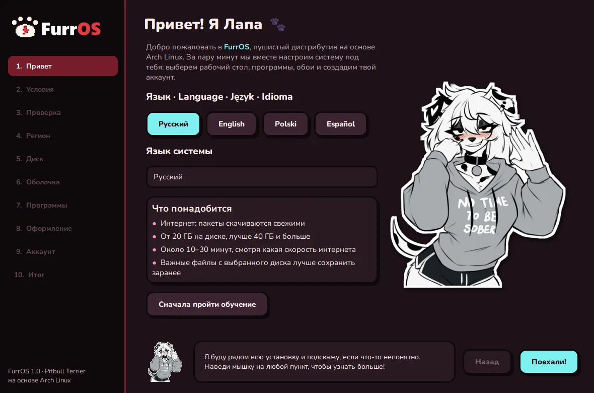

# FurrOS

**Русский** · [English](README.en.md) · [Polski](README.pl.md) · [Español](README.es.md)

**Пушистый дистрибутив Linux на основе Arch. Good dogs only. 🐾**

17 рабочих столов на выбор · установщик с Лапой · Школа Лапы · живые обои · без слежки и телеметрии

---

## ⚠️ Статус

**FurrOS ещё в разработке — ISO пока не выпущен.** Сборка меняется, поэтому образа, хэша и ссылки на загрузку здесь нет.

Хочешь узнать о выходе первым:

- ⭐ **Поставь звезду** репозиторию;
- 👀 нажми **Watch → Custom → Releases** — GitHub пришлёт уведомление в день релиза;
- ▶️ подпишись на [YouTube @FurrOSLinux](https://www.youtube.com/@FurrOSLinux) — там девлоги и показ системы;
- ✈️ подпишись на [Telegram-канал](https://t.me/FurrOS_Linux) — новости и анонс релиза прямо в ленте;
- 💬 заходи в [Discord](https://discord.gg/ZA3GuBYKwG) — новости первыми, помощь и чаты на русском и английском.

---

## Что будет в FurrOS

- **17 рабочих столов** — KDE, GNOME, COSMIC, Hyprland, Niri, Sway, i3 и другие. Все в едином стиле FurrOS.
- **Установщик с Лапой** — графическая установка на 4 языках (RU, EN, PL, ES). Лапа подсказывает на каждом шаге.
- **Школа Лапы** — встроенное обучение: 14 глав, тесты и терминал-песочница. Для тех, кто первый раз на Linux.
- **Живые обои** — анимированные обои на рабочем столе в KDE, Hyprland, Sway и Niri.
- **На основе Arch** — rolling-release, свежие версии программ, тысячи пакетов из репозиториев и AUR.
- **Бесплатно и открыто** — никакой слежки и телеметрии.

## 17 рабочих столов

| Классические | Плиточные | Без графики |
|---|---|---|
| KDE Plasma, GNOME, COSMIC, Cinnamon, Xfce, MATE, Budgie, LXQt, Deepin | Hyprland, Niri, Sway, i3, bspwm, Awesome, Qtile | Только консоль |

Выбор — один клик при установке, оформление везде в стиле FurrOS.

## Скриншоты

### Все рабочие столы
Каждый оформлен в стиле FurrOS сразу после установки.

| | | |
|:-:|:-:|:-:|
|  **KDE Plasma** |  **GNOME** |  **COSMIC** |
|  **Cinnamon** |  **Xfce** |  **MATE** |
|  **Budgie** |  **LXQt** |  **Deepin** |
|  **Hyprland** |  **Niri** |  **Sway** |
|  **i3** |  **bspwm** |  **Awesome** |
|  **Qtile** |  **Только консоль** |

### Установщик

### Школа Лапы

### Загрузка и вход

### Рабочие столы и обои

### Живые обои
12 живых обоев: на KDE, Hyprland, Sway и Niri они двигаются прямо на рабочем столе.

## Ссылки

- 🌐 Сайт: **[furros.xyz](https://furros.xyz/)**
- ▶️ YouTube: **[@FurrOSLinux](https://www.youtube.com/@FurrOSLinux)**
- 💬 Discord: **[discord.gg/ZA3GuBYKwG](https://discord.gg/ZA3GuBYKwG)**
- ✈️ Telegram: **[@FurrOS_Linux](https://t.me/FurrOS_Linux)**

## Лицензия

Код FurrOS распространяется по лицензии **[GNU GPL v3.0](LICENSE)**: его можно свободно использовать, изучать,
менять и распространять, а любые изменённые версии тоже должны оставаться открытыми под GPL-3.0.

Лицензия **не распространяется** на:
- название **FurrOS** и логотип-лапку — использовать их для своих проектов без разрешения нельзя;
- арт персонажей и художников (см. ниже) — права принадлежат авторам;
- пакеты Arch Linux и другие программы в образе — у каждого своя лицензия. Arch Linux — товарный знак его владельцев.

## Арт и права

FurrOS — некоммерческий фанатский проект. **Лапа** (далматинка) и другие персонажи, а также арт
на скриншотах рабочих столов и обоев принадлежат их авторам и используются в ознакомительных целях.

🎨 Художники, чьи арты используются в FurrOS: **lapalilpup**, **taroyadda**, **sashley**, **crispytyph**. Спасибо! 🐾

---

**Good dogs only. 🐾**

