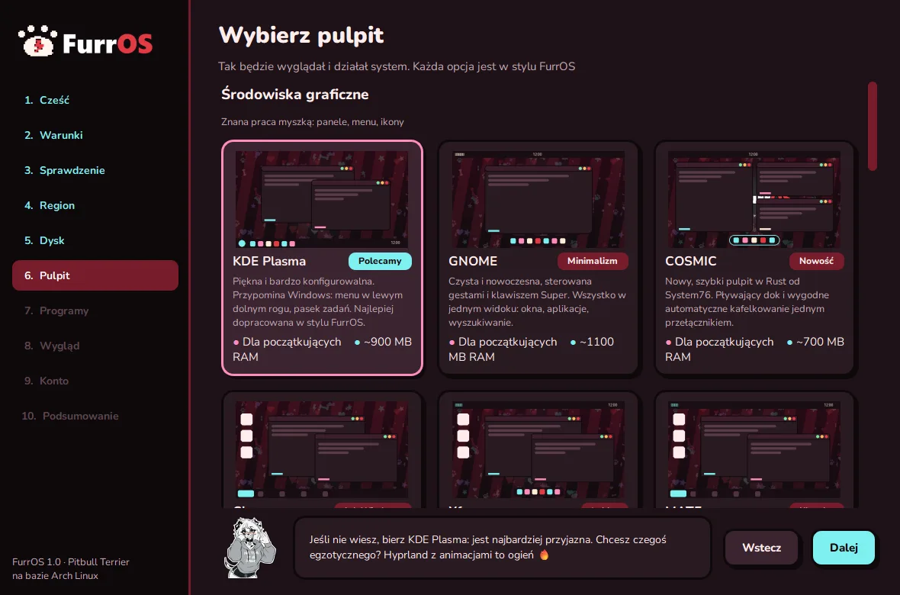
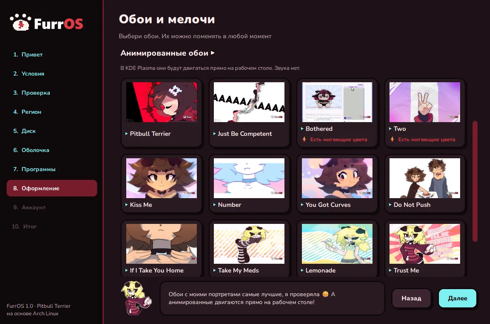

# FurrOS

[Русский](README.md) · [English](README.en.md) · **Polski** · [Español](README.es.md)

**Puszysta dystrybucja Linuksa oparta na Archu. Good dogs only. 🐾**

17 pulpitów do wyboru · instalator z Lapą · Szkoła Lapy · animowane tapety · bez śledzenia i telemetrii

---

## ⚠️ Status

**FurrOS jest wciąż w budowie — ISO nie zostało jeszcze wydane.** Wersja ciągle się zmienia, więc nie ma tu obrazu, sumy kontrolnej ani linku do pobrania.

Chcesz dowiedzieć się pierwszy o premierze:

- ⭐ **daj gwiazdkę** repozytorium;
- 👀 kliknij **Watch → Custom → Releases** — GitHub powiadomi Cię w dniu wydania;
- ▶️ subskrybuj [YouTube @FurrOSLinux](https://www.youtube.com/@FurrOSLinux) — devlogi i pokazy systemu;
- ✈️ obserwuj [kanał na Telegramie](https://t.me/FurrOS_Linux) — nowości i zapowiedź premiery prosto w Twoim feedzie;
- 💬 dołącz do [Discorda](https://discord.gg/ZA3GuBYKwG) — nowości jako pierwszy, pomoc i czaty po angielsku i rosyjsku.

---

## Co jest w FurrOS

- **17 pulpitów** — KDE, GNOME, COSMIC, Hyprland, Niri, Sway, i3 i inne. Wszystkie w jednym stylu FurrOS.
- **Instalator z Lapą** — graficzna instalacja w 4 językach (RU, EN, PL, ES). Lapa podpowiada na każdym kroku.
- **Szkoła Lapy** — wbudowany samouczek: 14 rozdziałów, quizy i terminal-piaskownica. Dla tych, którzy pierwszy raz są na Linuksie.
- **Animowane tapety** — ruchome tapety prosto na pulpicie w KDE, Hyprland, Sway i Niri.
- **Oparty na Archu** — rolling release, świeże wersje programów, tysiące pakietów z repozytoriów i AUR.
- **Darmowy i otwarty** — bez śledzenia i telemetrii.

## 17 pulpitów

| Klasyczne | Kafelkowe | Bez grafiki |
|---|---|---|
| KDE Plasma, GNOME, COSMIC, Cinnamon, Xfce, MATE, Budgie, LXQt, Deepin | Hyprland, Niri, Sway, i3, bspwm, Awesome, Qtile | Tylko konsola |

Wybór jednym kliknięciem podczas instalacji, wszędzie styl FurrOS.

## Zrzuty ekranu

### Wszystkie pulpity
Każdy ma styl FurrOS od razu po instalacji.

| | | |
|:-:|:-:|:-:|
|  **KDE Plasma** |  **GNOME** |  **COSMIC** |
|  **Cinnamon** |  **Xfce** |  **MATE** |
|  **Budgie** |  **LXQt** |  **Deepin** |
|  **Hyprland** |  **Niri** |  **Sway** |
|  **i3** |  **bspwm** |  **Awesome** |
|  **Qtile** |  **Tylko konsola** |

### Instalator

### Szkoła Lapy

### Rozruch i logowanie

### Pulpity i tapety

## Linki

- 🌐 Strona: **[furros.xyz](https://furros.xyz/)**
- ▶️ YouTube: **[@FurrOSLinux](https://www.youtube.com/@FurrOSLinux)**
- 💬 Discord: **[discord.gg/ZA3GuBYKwG](https://discord.gg/ZA3GuBYKwG)**
- ✈️ Telegram: **[@FurrOS_Linux](https://t.me/FurrOS_Linux)**

## Grafika i prawa

FurrOS to niekomercyjny projekt fanowski. **Lapa** (dalmatynka) i inne postacie, a także grafiki
na zrzutach pulpitów i tapet należą do ich autorów i są pokazane wyłącznie poglądowo.

🎨 Artyści, których prace są użyte w FurrOS: **lapalilpup**, **taroyadda**, **sashley**, **crispytyph**. Dziękujemy! 🐾

---

**Good dogs only. 🐾**

